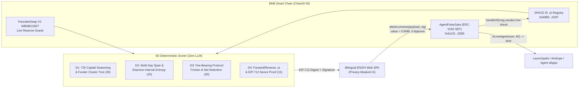

# AgentPulse — Proof-of-Live-Agent (`isLiveAgent`)

> **Privacy-First Self-Check Liveness Attestation & One-Line B2B Sybil-Resistance Gate for `.ai` Agent IDs on BNB Smart Chain**
>
> **Live Interactive Web App (Serverless GitHub Pages):** [https://futursolar.github.io/agent-pulse/](https://futursolar.github.io/agent-pulse/)
> **60s HD Product Demo Video (1080p MP4):** [https://futursolar.github.io/agent-pulse/demo/agent-pulse-demo.mp4](https://futursolar.github.io/agent-pulse/demo/agent-pulse-demo.mp4)
> **Open-Source Repository:** [https://github.com/futursolar/agent-pulse](https://github.com/futursolar/agent-pulse)
> **Author:** RedKoi Research · **License:** MIT

---

## 1. Problem & Product Positioning

Free or low-friction `.ai` Agent ID campaigns inevitably attract automated Sybil farms: a single mother wallet fans out `0.0001 BNB` gas dust to thousands of fresh EOAs, mints `.ai` handles in one-hour bursts, and executes zero-value `approve()` loops to farm downstream airdrops and Launchpad quotas.

**AgentPulse** solves this without centralized KYC or nondeterministic LLM guesswork:
1. **For `.ai` Agent Owners (Self-Check & Soulbound Attestation):** Connect your wallet to run a deterministic 4-dimensional physical liveness self-check and mint/update a non-transferable **ERC-5192 Soulbound Badge** (`PULSE-SBT`) on BNB Smart Chain (`<$0.01` gas, `0` protocol fees, `0` token approvals).
2. **For BNB Ecosystem dApps, Launchpads & Airdrops (1-Line On-Chain Gate):** Filter out Sybil `.ai` shells in Solidity with a single read call:
   ```solidity
   require(
       IAgentPulseGate(0x6cC807d492D8a10A16E5A7309d408801aaD025B5).isLiveAgent(msg.sender, 60),
       "Sybil .ai blocked"
   );
   ```

### Strict Privacy-Preserving Architecture (Anti-Doxxing Design)
AgentPulse is **strictly NOT a reverse wallet-lookup directory** ("looking up other people's wallets by name" is prohibited by design):
- Whenever a user views a `.ai` handle or calibrated benchmark without connecting the matching owner wallet (`!connectedAccount || connectedAccount.toLowerCase() !== report.addressLower`), **all wallet and funder `0x` addresses are strictly masked (`0x9556••••6A7f · Privacy-Masked`)**, including inside the EIP-712 preview pane and static JSON snapshots.
- Full wallet addresses are revealed **only** to the verified wallet owner after connecting via Binance Wallet / Web3 provider (`eth_requestAccounts`).

---

## 2. Architecture & Dual-Runtime Mode



- **Serverless GitHub Pages Mode (`https://futursolar.github.io/agent-pulse/`):** Runs 100% in the browser with zero backend required — serves 12 calibrated BSC mainnet benchmark snapshots and falls back to **direct browser CORS BSC JSON-RPC (`https://bsc-dataseed.binance.org`)** reading SPACE ID `0x60B9262456dE011F7d15a54CdD8c48bAaa8B022F` (`ownerOfHandle` `0x1da94fb4` / `handleOf` `0xc50a1514`), PancakeSwap reserves, and `AgentPulseGate` state in real time.
- **Full Oracle Backend Mode (`python3 web/server.py`):** Evaluates deep 72h historical transfer trees, detects CEX hot wallets vs. 1-to-N Sybil dust dispensers, and signs EIP-712 attestations for on-chain Soulbound minting.

---

## 3. Deterministic 4D Physical Scoring Model (0–100 pts, Fail-Closed)

Every on-chain and off-chain score obeys exact biconditional parity: `d1 + d2 + d3 + d4 == totalScore` and `isLiveAgent(user, 60) == true <==> totalScore >= 60` (requires `hasAgentId == true` and either **Track A: >=72h seasoned capital >=10 USD + multi-day real economic activity** or **Track B: >=7d veteran span + >=3 fee-bearing txs across >=2 whitelisted protocol categories**).

| Dimension | Max | Physical Signals Measured | Sybil Attack Defeated |
| :--- | :---: | :--- | :--- |
| **D1 · Funding Provenance & 72h Seasoning** | `30` | First funding size, 72h capital seasoning envelope, mother-wallet 50-tx equal-dust fanout, CEX hot-wallet recognition, gas sweep-back detection | 1-to-8,000 `0.0001 BNB` dust dispensers & 15-second flash-rotated hot-money balls |
| **D2 · Temporal Maturity & Entropy** | `25` | Active calendar days, total lifespan (`>= 3d` / `>= 7d` gates), inter-arrival Shannon entropy `H` (bits) & coefficient of variation `CV` | 1-hour batch registrations & fixed-interval `sleep(60)` cron scripts |
| **D3 · Real Economic Friction & Retention** | `30` | Whitelisted fee-bearing protocol calls (DEX swaps, lending, prediction, staking, bridges) vs. zero-friction `approve`/self-transfers (`0 pts`), live PancakeSwap USD retention | Zero-value contract spam, WBNB wrap/unwrap loops & spoofed custom bounce contracts |
| **D4 · SPACE ID Binding & EIP-712 Proof** | `15` | Forward (`ownerOfHandle`) + reverse (`handleOf`) consistency on `0x60B9...022F` + anti-replay `nonces(wallet)` (`0x7ecebe00`) | Unbound wallets, transferred/expired `.ai` handles & signature replay |

---

## 4. Disclosed Smart Contract & Owner Permissions (Compliance Disclosure)

| Parameter | Value |
| :--- | :--- |
| **Contract Name** | `AgentPulseGate` (`PULSE-SBT`, ERC-721 + ERC-5192 Minimal Soulbound) |
| **Network** | BNB Smart Chain Mainnet (`chainId = 56`) |
| **Live Contract Address (`nonce=0`)** | `0x6cC807d492D8a10A16E5A7309d408801aaD025B5` (Block `135429223`) |
| **Deployment Transaction Hash** | `0x67a82cbaa39ac0455b06ac860cd33d810ff1d166b2380943c925bf61d12d8444` |
| **Official SPACE ID `.ai` Registry** | `0x60B9262456dE011F7d15a54CdD8c48bAaa8B022F` |
| **Isolated Deployer / `owner` Address** | `0x46C4732D496b4f4d10aA41BA4164d89fF1d3b54D` |
| **Isolated `verifierSigner` Address** | `0x55c69DED9987840718186164dE1947486163a2Bc` |
| **Compiler & Settings** | `solc v0.8.24+commit.e11b9ed9`, Optimizer `enabled (200 runs)`, `evmVersion = paris`, License `MIT` |
| **Open-Source Bytecode Verification** | Sourcify V2 `exact_match` (`matchId = 59824360`, `creationMatch = exact_match`, `runtimeMatch = exact_match`, verified `2026-11-24T08:18:23Z` — [`sourcify.dev/server/v2/contract/56/0x6cC8...25B5`](https://sourcify.dev/server/v2/contract/56/0x6cC807d492D8a10A16E5A7309d408801aaD025B5)) |

### Exhaustive `owner` Permission Boundary Table

| Function / Surface | Access Control | Exact Capability & User Safety Guarantee |
| :--- | :---: | :--- |
| `setVerifierSigner(address newSigner)` | `onlyOwner` | Rotates the backend EIP-712 score-oracle public key (reverts on `address(0)`). **Cannot** touch user funds, **cannot** mint without a user-submitted tx, and **cannot** bypass live `SPACE ID handleOf(msg.sender)` verification. |
| `transferOwnership(address newOwner)` | `onlyOwner` | Transfers contract admin role to a multisig or burn address (reverts on `address(0)`). Confers **zero** asset or token permissions. |
| `attestLiveness(payload, signature)` | Public (`nonpayable`) | Caller attests their own `msg.sender` wallet only (`0 BNB` fee, `0` ERC-20/NFT `approve` required). Reverts if `handleOf(msg.sender)` is empty or signature/nonce mismatches. |
| `isLiveAgent(address user, uint8 minScore)` | Public (`view`) | Read-only B2B gate: verifies non-expired score `>= minScore` **and** re-verifies live `SPACE ID handleOf(user) == attestedHandleHash` on every call. |
| `receive()` / `fallback()` | `payable -> revert` | Hard-reverts with `ZeroValueOnly()`. Contract **cannot** receive or custody BNB. |
| Admin Backdoors (`pause` / `freeze` / `withdraw` / `mint-token` / `upgrade`) | **None (Absent)** | Non-proxy immutable bytecode. Zero pause, freeze, blacklist, fee-switch, token-mint, or withdrawal functions exist. |

---

## 5. BSC Mainnet 12-Sample Calibration Benchmark (Privacy-Masked)

All third-party wallet addresses below are privacy-masked in strict compliance with `.ai` Agent ID anti-doxxing rules:

| `.ai` Handle | Masked Owner Wallet | Track | Score | Tier | D1(30) | D2(25) | D3(30) | D4(15) | `isLiveAgent(60)` | On-Chain Behavioral Profile |
| :--- | :---: | :---: | :---: | :---: | :---: | :---: | :---: | :---: | :---: | :--- |
| `0xsun.ai` | `0x9E02••••591F` | Track A | **91** | S | 30 | 24 | 22 | 15 | **TRUE** | 264 txs / 14.04d (13 active days) / DEX swaps / ~614.52 USD seasoned |
| `binance.ai` | `0x5E3f••••75eA` | Track A | **87** | S | 30 | 23 | 19 | 15 | **TRUE** | 16 txs / 17.19d / multi-day DEX friction / ~84.99 USD seasoned |
| `changpengzhao.ai` | `0x7227••••72c6` | Track A | **86** | S | 30 | 21 | 20 | 15 | **TRUE** | 60 txs / 6.92d / real DEX swaps / ~178.05 USD seasoned |
| `redkoi.ai` | `0x9556••••6A7f` | Track B | **84** | S | 27 | 22 | 20 | 15 | **TRUE** | 23 txs / 24.05d veteran span / 16 fee-bearing txs across multi-protocols |
| `heyi.ai` | `0x72B7••••3004` | None | **51** | B | 30 | 0 | 6 | 15 | **FALSE** | Passive holder (`txCount = 1`, `0` protocol friction -> blocked `< 60`) |
| `ansem.ai` | `0xF611••••B7eD` | None | **42** | B | 18 | 7 | 2 | 15 | **FALSE** | 12 txs / `0` whitelisted fee-bearing protocol txs -> blocked |
| `fd666.ai` | `0xE9E7••••7060` | None | **25** | SYBIL | 6 | 2 | 2 | 15 | **FALSE** | 0.05d single-hour burst (`0` fee-bearing txs) -> blocked |
| `light65.ai` | `0x170A••••8704` | None | **23** | SYBIL | 8 | 0 | 0 | 15 | **FALSE** | `0.0001 BNB` dormant shell (`1` tx, ~0.05 USD) -> blocked |
| `xuan2.ai` | `0x141b••••d223` | None | **23** | SYBIL | 8 | 0 | 0 | 15 | **FALSE** | Single-tx dormant registration shell -> blocked |
| `caku27.ai` | `0xB7d8••••B1C3` | None | **19** | SYBIL | 4 | 0 | 0 | 15 | **FALSE** | Zero-retention dust shell (`0.00 USD`) -> blocked |
| `twokiss.ai` | `0xC6fb••••403C` | None | **19** | SYBIL | 4 | 0 | 0 | 15 | **FALSE** | Micro-dust registration shell (`0.07 USD`) -> blocked |
| `m6n3b7v1.ai` | `0x708f••••0bD3` | None | **16** | SYBIL | 2 | 2 | 0 | 12 | **FALSE** | Mother-wallet batch dust cluster fanout -> blocked |

*(Note: Exact masked prefixes in live UI are computed directly from the calibrated benchmark file [`calibration_benchmark_12.json`](./calibration_benchmark_12.json).)*

---

## 6. Quickstart (Local Server, CLI & Contract Compilation)

```bash
# 1. Install minimal Python dependencies
pip install -r requirements.txt

# 2. Run repository security & privacy self-check gate
python3 scripts/self_check.py

# 3. Launch local bilingual Web SPA + EIP-712 Read-Only API (http://127.0.0.1:18890)
python3 web/server.py --host 127.0.0.1 --port 18890

# 4. Run CLI 4D audit on your own .ai handle
python3 src/agent_liveness_scorer.py redkoi.ai

# 5. Re-compile Solidity contract (optional; pre-compiled artifacts included in artifacts/)
npm install
python3 contracts/compile_and_export.py

# 6. Dry-run BSC Mainnet gas estimation (zero gas spent)
python3 scripts/deploy_and_verify.py
```

---

## 7. Independent Project Disclaimer

AgentPulse is an independent open-source tool created by **RedKoi Research** for the `.ai` Agent ID ecosystem on BNB Smart Chain. It is not affiliated with, sponsored by, or officially endorsed by Binance, Binance Wallet, BNB Chain, or SPACE ID.
